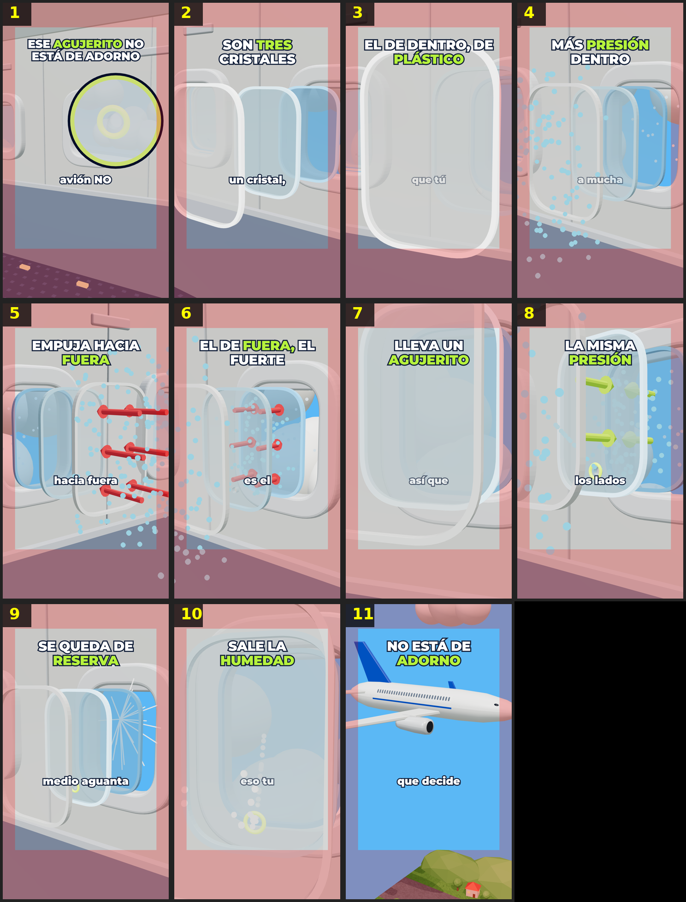

# Storyboard: agujero-ventanilla (3d)

| panel | scene | t (s) | type | title | stat |
|---|---|---|---|---|---|
| 1 | hook | 2.24 | question | Ese agujerito NO está de adorno |  |
| 2 | tres | 5.36 | object | Son tres cristales |  |
| 3 | plastico | 9.02 | object | El de dentro, de plástico |  |
| 4 | presion | 13.05 | process | Más presión dentro |  |
| 5 | empuja | 16.82 | process | Empuja hacia fuera |  |
| 6 | fuerte | 20.97 | object | El de fuera, el fuerte |  |
| 7 | agujero | 25.13 | object | Lleva un agujerito |  |
| 8 | misma | 30.34 | process | La misma presión |  |
| 9 | reserva | 36.52 | stat | Se queda de reserva | ×1,5 |
| 10 | humedad | 42.25 | process | Sale la humedad |  |
| 11 | cierre | 47.38 | closing | NO está de adorno |  |
