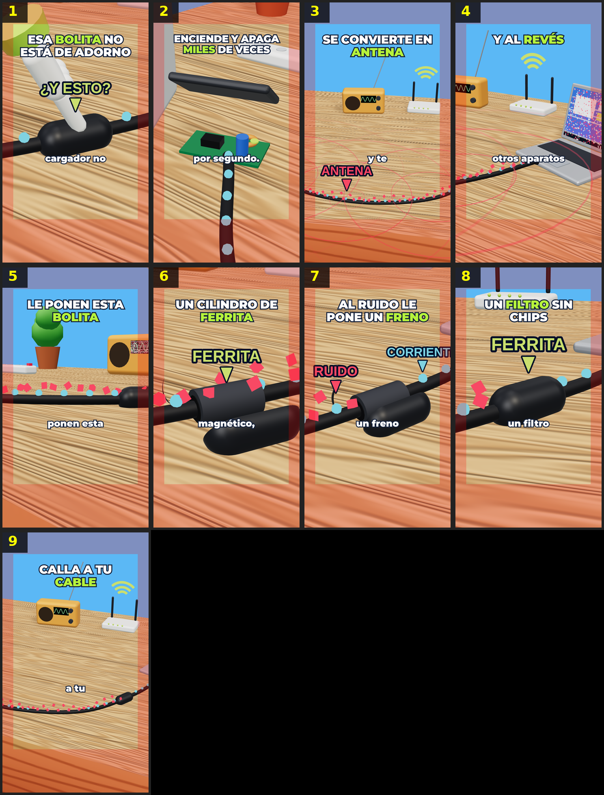

# Storyboard: bolita-cargador (3d)

| panel | scene | t (s) | type | title | stat |
|---|---|---|---|---|---|
| 1 | hook | 2.04 | question | Esa bolita NO está de adorno |  |
| 2 | ruido | 8.48 | process | Enciende y apaga miles de veces |  |
| 3 | antena | 15.98 | process | Se convierte en antena |  |
| 4 | reves | 22.37 | comparison | Y al revés |  |
| 5 | bolita | 25.93 | object | Le ponen esta bolita |  |
| 6 | ferrita | 30.22 | object | Un cilindro de ferrita |  |
| 7 | filtro | 36.9 | process | Al ruido le pone un freno |  |
| 8 | nombre | 41.84 | object | Un filtro sin chips |  |
| 9 | cierre | 46.48 | closing | Calla a tu cable |  |
