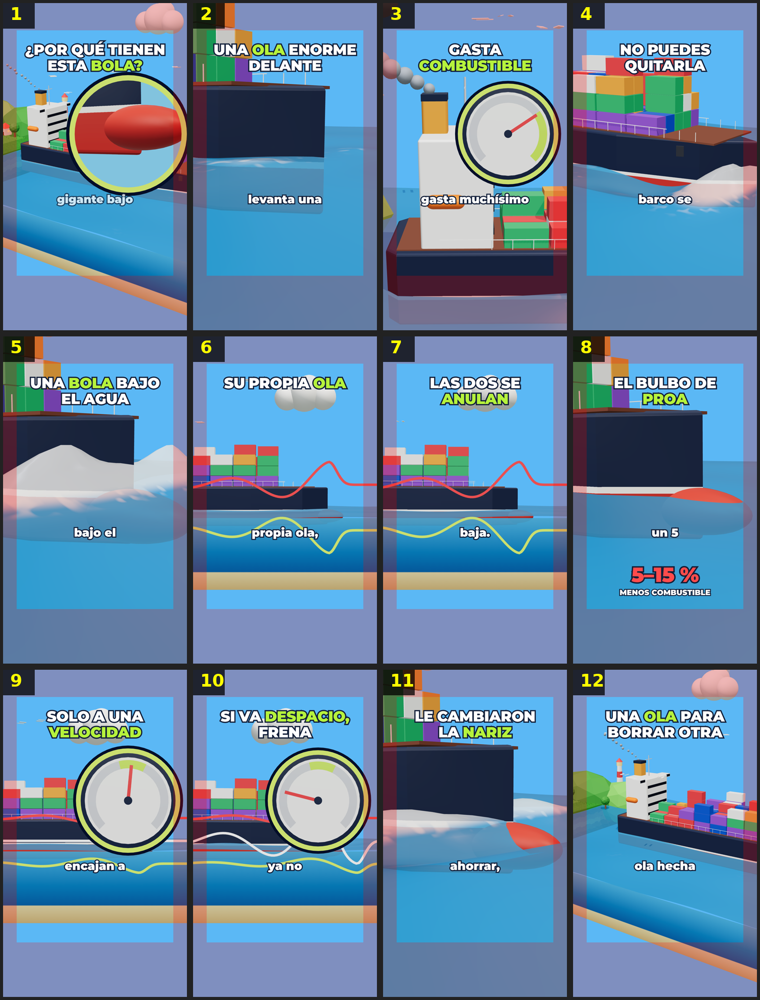

# Storyboard: bulbo-proa (3d)

| panel | scene | t (s) | type | title | stat |
|---|---|---|---|---|---|
| 1 | hook | 2.16 | question | ¿Por qué tienen esta bola? |  |
| 2 | ola | 6.32 | process | Una ola enorme delante |  |
| 3 | combustible | 9.85 | stat | Gasta combustible |  |
| 4 | pero | 13.55 | question | No puedes quitarla |  |
| 5 | bola | 17.33 | object | Una bola bajo el agua |  |
| 6 | desfase | 20.91 | process | Su propia ola |  |
| 7 | anulan | 24.82 | comparison | Las dos se anulan |  |
| 8 | nombre | 30.07 | stat | El bulbo de proa | 5–15 % |
| 9 | truco | 35.08 | process | Solo a una velocidad |  |
| 10 | despacio | 39.24 | comparison | Si va despacio, frena |  |
| 11 | nariz | 44.47 | process | Le cambiaron la nariz |  |
| 12 | cierre | 50.08 | closing | Una ola para borrar otra |  |
