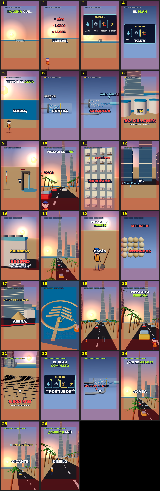

# Storyboard: dubai-desierto (3d)

| panel | scene | t (s) | type | title | stat |
|---|---|---|---|---|---|
| 1 | hook | 5.73 | question | Imagina que… |  |
| 2 | sin | 11.94 | question |  |  |
| 3 | promesa | 16.22 | question |  |  |
| 4 | plan | 22.92 | object | El plan |  |
| 5 | agua | 30.36 | process | Pieza 1: el agua |  |
| 6 | desal | 38.23 | process |  |  |
| 7 | salida | 43.74 | process |  |  |
| 8 | jebel | 48.61 | stat |  | 182 MILLONES |
| 9 | grifo | 52.48 | object |  |  |
| 10 | frio | 56.95 | process | Pieza 2: el frío |  |
| 11 | ventanas | 61.58 | comparison |  |  |
| 12 | tubos | 66.38 | process |  |  |
| 13 | guinness | 71.34 | stat |  | RÉCORD |
| 14 | ciudadac | 75.85 | object |  |  |
| 15 | tierra | 80.71 | process | Pieza 3: la tierra |  |
| 16 | granos | 87.27 | comparison |  |  |
| 17 | importa | 92.56 | process |  |  |
| 18 | isla | 99.05 | process |  | 94 MILLONES |
| 19 | muro | 106.24 | question |  |  |
| 20 | energia | 111.72 | process | Pieza 4: la energía |  |
| 21 | solar | 118.05 | stat |  | 3.800 MW |
| 22 | tablero | 126.95 | object | El plan completo |  |
| 23 | precio | 134.19 | comparison |  |  |
| 24 | apaga | 140.44 | question | ¿Y si se apaga? |  |
| 25 | maquina | 146.49 | closing |  |  |
| 26 | pregunta | 149.92 | closing | ¿Vivirías ahí? |  |
