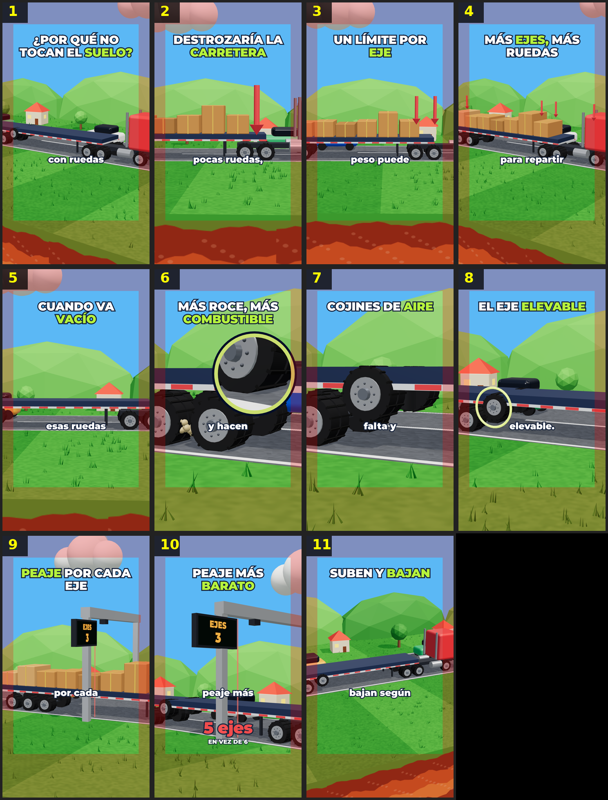

# Storyboard: eje-camion (3d)

| panel | scene | t (s) | type | title | stat |
|---|---|---|---|---|---|
| 1 | hook | 1.82 | question | ¿Por qué no tocan el suelo? |  |
| 2 | peso | 6.35 | process | Destrozaría la carretera |  |
| 3 | ley | 10.47 | object | Un límite por eje |  |
| 4 | ejes | 14.44 | process | Más ejes, más ruedas |  |
| 5 | vacio | 18.26 | question | Cuando va vacío |  |
| 6 | gastan | 22.15 | process | Más roce, más combustible |  |
| 7 | cojines | 27.76 | process | Cojines de aire |  |
| 8 | nombre | 32.21 | object | El eje elevable |  |
| 9 | peaje | 35.95 | process | Peaje por cada eje |  |
| 10 | barato | 38.96 | stat | Peaje más barato | 5 ejes |
| 11 | cierre | 42.87 | closing | Suben y bajan |  |
