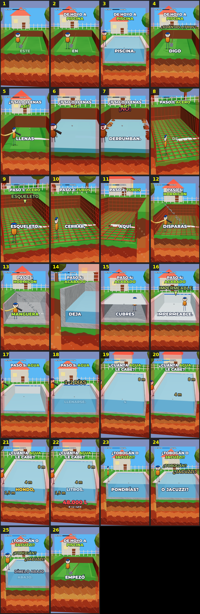

# Storyboard: hoyo-piscina (3d)

| panel | scene | t (s) | type | title | stat |
|---|---|---|---|---|---|
| 1 | hook | 0 | question | De hoyo a piscina |  |
| 2 | problema | 1.5 | question | ¿Y si lo llenas así? |  |
| 3 | acero | 3.2 | process | Paso 1: acero |  |
| 4 | tubos | 4.5 | process | Paso 2: tubos |  |
| 5 | hormigon | 6.5 | process | Paso 3: hormigón |  |
| 6 | acabado | 8.4 | process | Paso 4: acabado |  |
| 7 | agua | 9.5 | process | Paso 5: agua |  |
| 8 | premio | 11.8 | stat | ¿Cuánta agua le cabe? | 48.000 L |
| 9 | pregunta | 13 | closing | ¿Tobogán o jacuzzi? |  |
| 10 | loop | 14.5 | closing | De hoyo a piscina |  |
