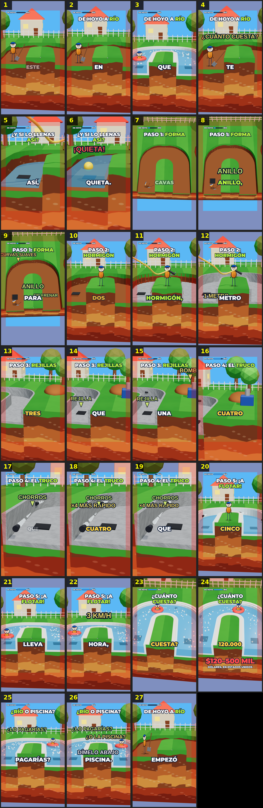

# Storyboard: hoyo-rio (3d)

| panel | scene | t (s) | type | title | stat |
|---|---|---|---|---|---|
| 1 | hook | 0 | question | De hoyo a río |  |
| 2 | problema | 1.5 | question | ¿Y si lo llenas así? |  |
| 3 | forma | 3 | process | Paso 1: forma |  |
| 4 | hormigon | 4.8 | process | Paso 2: hormigón |  |
| 5 | rejillas | 6.6 | process | Paso 3: rejillas |  |
| 6 | chorros | 8.2 | process | Paso 4: el truco |  |
| 7 | flota | 10 | process | Paso 5: ¡a flotar! |  |
| 8 | premio | 11.2 | stat | ¿Cuánto cuesta? | $120–500 MIL |
| 9 | pregunta | 12.6 | closing | ¿Río o piscina? |  |
| 10 | loop | 14.2 | closing | De hoyo a río |  |
