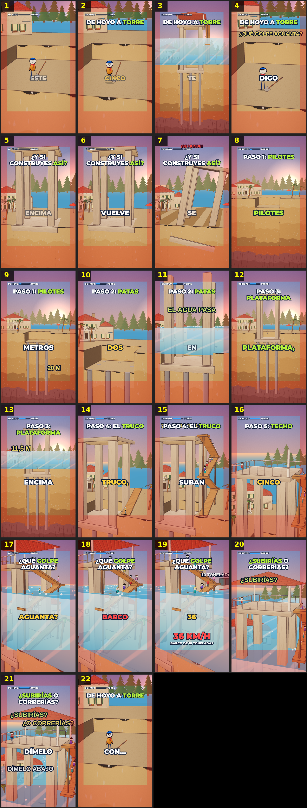

# Storyboard: hoyo-torre (3d)

| panel | scene | t (s) | type | title | stat |
|---|---|---|---|---|---|
| 1 | hook | 0 | question | De hoyo a torre |  |
| 2 | problema | 1.5 | question | ¿Y si construyes así? |  |
| 3 | pilotes | 3 | process | Paso 1: pilotes |  |
| 4 | patas | 5 | process | Paso 2: patas |  |
| 5 | plataforma | 7 | process | Paso 3: plataforma |  |
| 6 | escaleras | 8.6 | process | Paso 4: el truco |  |
| 7 | techo | 10.2 | process | Paso 5: techo |  |
| 8 | premio | 11.8 | stat | ¿Qué golpe aguanta? | 36 KM/H |
| 9 | pregunta | 13.6 | closing | ¿Subirías o correrías? |  |
| 10 | loop | 15.2 | closing | De hoyo a torre |  |
