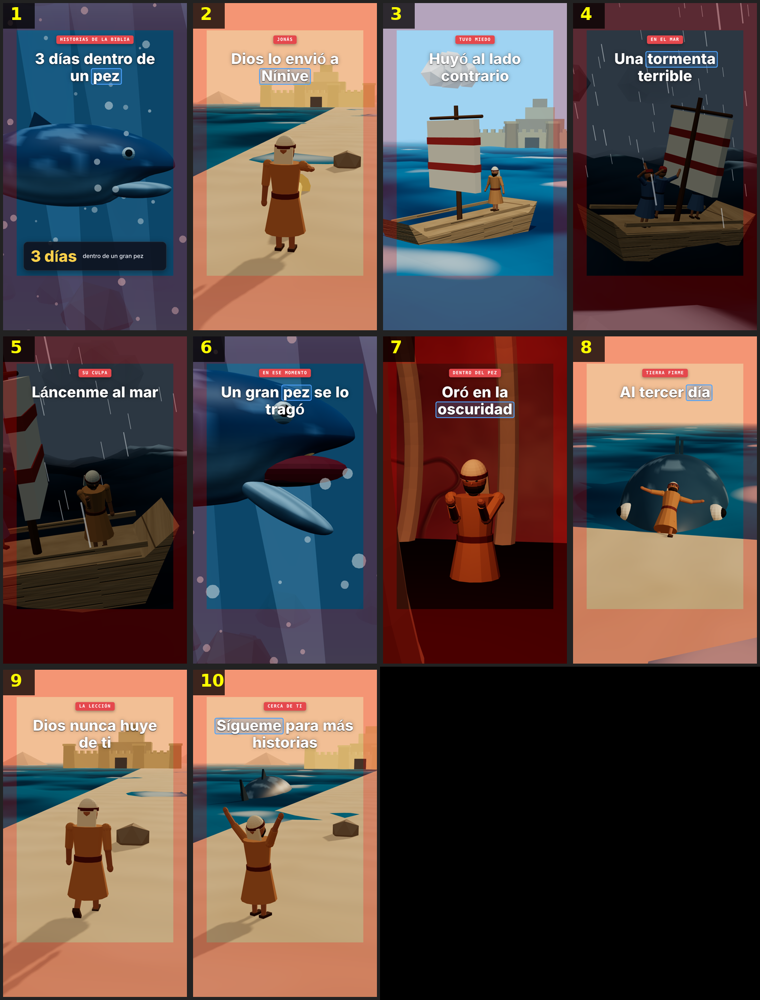

# Storyboard: jonas (3d)

| panel | scene | t (s) | type | title | stat |
|---|---|---|---|---|---|
| 1 | hook | 3.9 | question | 3 días dentro de un pez | 3 días |
| 2 | call | 8.81 | object | Dios lo envió a Nínive |  |
| 3 | flee | 13.49 | process | Huyó al lado contrario |  |
| 4 | storm | 18.84 | object | Una tormenta terrible |  |
| 5 | guilt | 24.79 | process | Láncenme al mar |  |
| 6 | swallow | 29.12 | object | Un gran pez se lo tragó |  |
| 7 | belly | 33.41 | object | Oró en la oscuridad |  |
| 8 | shore | 37.51 | object | Al tercer día |  |
| 9 | lesson | 41.42 | closing | Dios nunca huye de ti |  |
| 10 | follow | 44.79 | closing | Sígueme para más historias |  |
