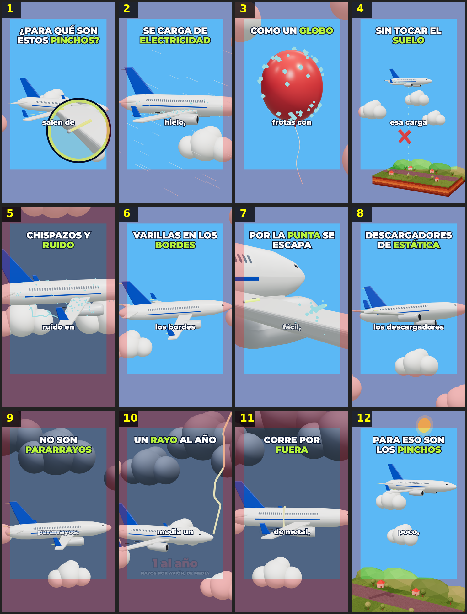

# Storyboard: pinchos-avion (3d)

| panel | scene | t (s) | type | title | stat |
|---|---|---|---|---|---|
| 1 | hook | 1.83 | question | ¿Para qué son estos pinchos? |  |
| 2 | carga | 6.44 | process | Se carga de electricidad |  |
| 3 | globo | 9.83 | object | Como un globo |  |
| 4 | suelo | 13.71 | question | Sin tocar el suelo |  |
| 5 | chispa | 19.21 | process | Chispazos y ruido |  |
| 6 | varillas | 23.81 | object | Varillas en los bordes |  |
| 7 | punta | 29.32 | process | Por la punta se escapa |  |
| 8 | nombre | 33.2 | object | Descargadores de estática |  |
| 9 | pararrayos | 35.27 | question | No son pararrayos |  |
| 10 | rayo | 37.52 | stat | Un rayo al año | 1 al año |
| 11 | piel | 41.74 | process | Corre por fuera |  |
| 12 | cierre | 47.79 | closing | Para eso son los pinchos |  |
