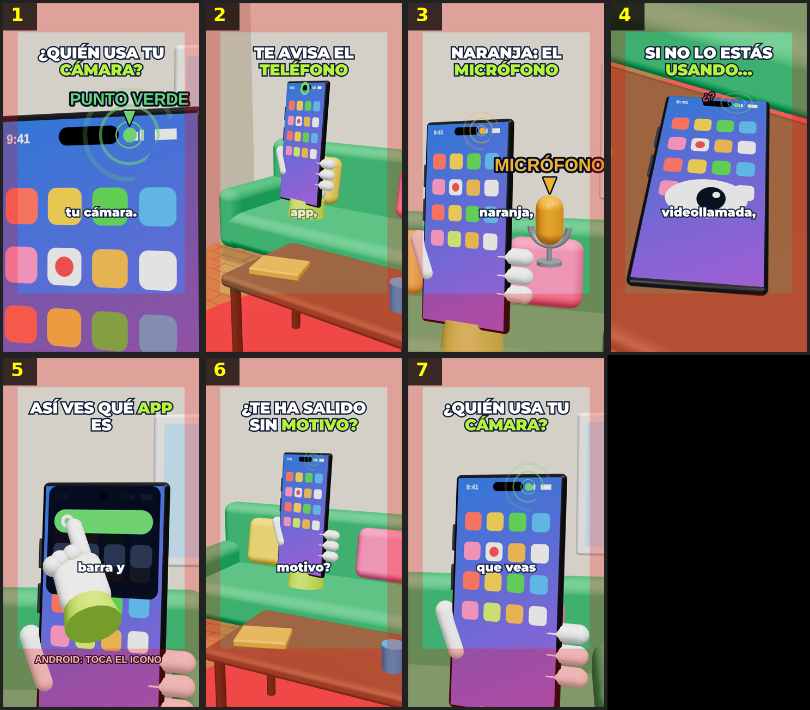

# Storyboard: punto-verde (3d)

| panel | scene | t (s) | type | title | stat |
|---|---|---|---|---|---|
| 1 | hook | 0 | question | ¿Quién usa tu cámara? |  |
| 2 | sistema | 1 | object | Te avisa el teléfono |  |
| 3 | naranja | 2 | comparison | Naranja: el micrófono |  |
| 4 | raro | 3 | question | Si no lo estás usando… |  |
| 5 | premio | 4 | process | Así ves qué app es |  |
| 6 | pregunta | 5 | closing | ¿Te ha salido sin motivo? |  |
| 7 | loop | 6 | closing | ¿Quién usa tu cámara? |  |
