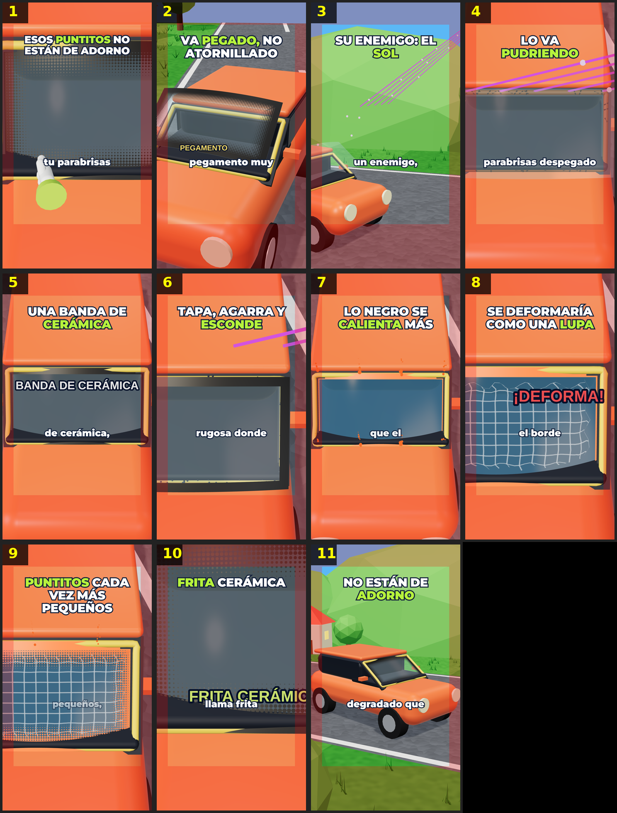

# Storyboard: puntos-parabrisas (3d)

| panel | scene | t (s) | type | title | stat |
|---|---|---|---|---|---|
| 1 | hook | 2.45 | question | Esos puntitos NO están de adorno |  |
| 2 | pegado | 7.52 | process | Va pegado, no atornillado |  |
| 3 | sol | 11.59 | question | Su enemigo: el sol |  |
| 4 | pudre | 15.86 | process | Lo va pudriendo |  |
| 5 | banda | 20.41 | object | Una banda de cerámica |  |
| 6 | protege | 25.22 | process | Tapa, agarra y esconde |  |
| 7 | calor | 29.5 | process | Lo negro se calienta más |  |
| 8 | lupa | 34.19 | comparison | Se deformaría como una lupa |  |
| 9 | puntos | 40.51 | process | Puntitos cada vez más pequeños |  |
| 10 | nombre | 44.38 | object | Frita cerámica |  |
| 11 | cierre | 48.65 | closing | NO están de adorno |  |
