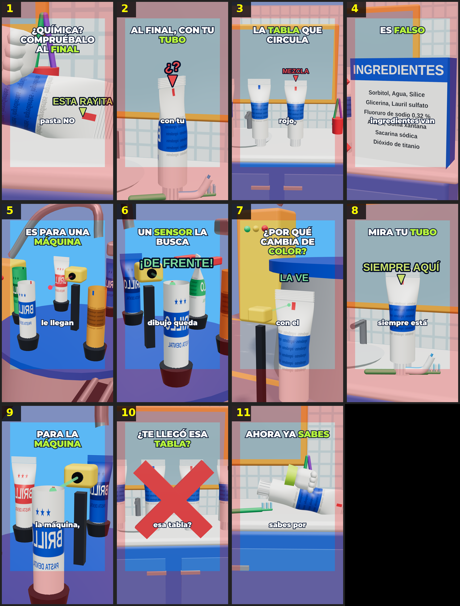

# Storyboard: rayita-pasta (3d)

| panel | scene | t (s) | type | title | stat |
|---|---|---|---|---|---|
| 1 | hook | 0 | question | ¿Química? Compruébalo al final |  |
| 2 | promesa | 1 | question | Al final, con tu tubo |  |
| 3 | tabla | 2 | comparison | La tabla que circula |  |
| 4 | falso | 3 | stat | Es falso |  |
| 5 | maquina | 4 | object | Es para una máquina |  |
| 6 | sensor | 5 | process | Un sensor la busca |  |
| 7 | color | 6 | comparison | ¿Por qué cambia de color? |  |
| 8 | premio | 7 | process | Mira tu tubo |  |
| 9 | parati | 8 | object | Para la máquina |  |
| 10 | pregunta | 9 | closing | ¿Te llegó esa tabla? |  |
| 11 | loop | 10 | closing | Ahora ya sabes |  |
