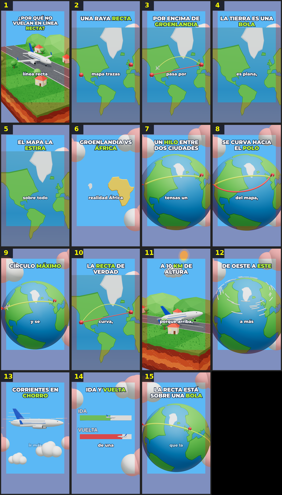

# Storyboard: rutas-avion (3d)

| panel | scene | t (s) | type | title | stat |
|---|---|---|---|---|---|
| 1 | hook | 1.66 | question | ¿Por qué no vuelan en línea recta? |  |
| 2 | raya | 5.08 | map | Una raya recta |  |
| 3 | arriba | 8.66 | map | Por encima de Groenlandia |  |
| 4 | bola | 11.66 | object | La Tierra es una bola |  |
| 5 | estira | 15.54 | process | El mapa la estira |  |
| 6 | groenlandia | 21.06 | comparison | Groenlandia vs África | 14 veces |
| 7 | hilo | 26.06 | process | Un hilo entre dos ciudades |  |
| 8 | polo | 29.85 | comparison | Se curva hacia el polo |  |
| 9 | circulo | 34.01 | object | Círculo máximo |  |
| 10 | plano | 38.8 | map | La recta de verdad |  |
| 11 | altura | 43.08 | process | A 10 km de altura |  |
| 12 | viento | 47.43 | stat | De oeste a este | +200 km/h |
| 13 | chorro | 53.26 | process | Corrientes en chorro |  |
| 14 | vuelta | 58.13 | comparison | Ida y vuelta | +1 hora |
| 15 | cierre | 62.85 | closing | La recta está sobre una bola |  |
