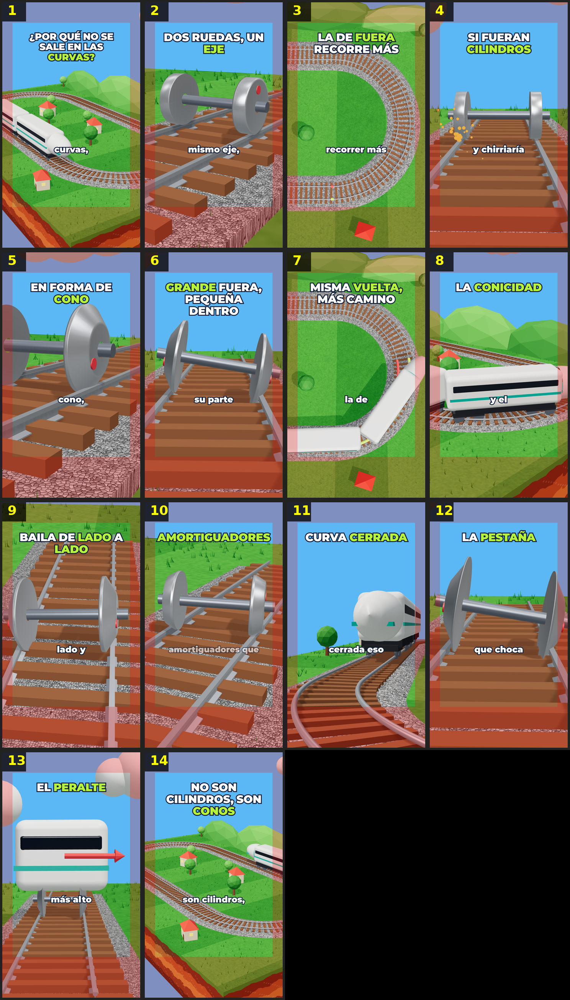

# Storyboard: tren-curvas (3d)

| panel | scene | t (s) | type | title | stat |
|---|---|---|---|---|---|
| 1 | hook | 2.03 | question | ¿Por qué no se sale en las curvas? |  |
| 2 | eje | 5.79 | object | Dos ruedas, un eje |  |
| 3 | fuera | 9.96 | comparison | La de fuera recorre más |  |
| 4 | cilindros | 14.09 | process | Si fueran cilindros |  |
| 5 | cono | 17.74 | object | En forma de cono |  |
| 6 | apoya | 22.65 | process | Grande fuera, pequeña dentro |  |
| 7 | vuelta | 26.63 | comparison | Misma vuelta, más camino |  |
| 8 | conicidad | 29.42 | object | La conicidad |  |
| 9 | baile | 33.89 | process | Baila de lado a lado |  |
| 10 | amort | 38.92 | process | Amortiguadores |  |
| 11 | cerrada | 42.1 | question | Curva cerrada |  |
| 12 | pestana | 46.52 | object | La pestaña |  |
| 13 | peralte | 52.55 | process | El peralte |  |
| 14 | cierre | 58.08 | closing | No son cilindros, son conos |  |
